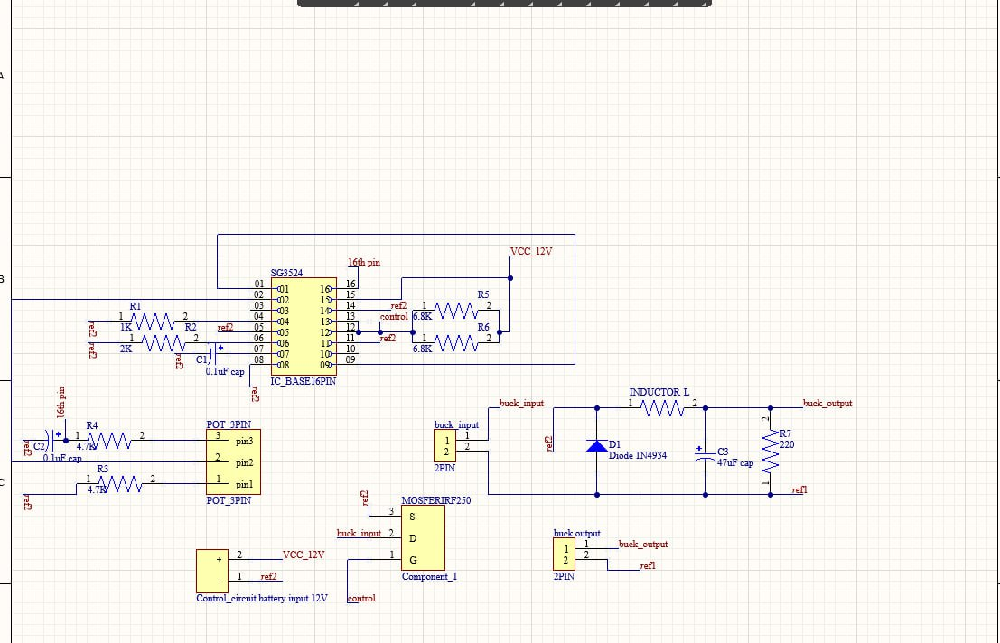
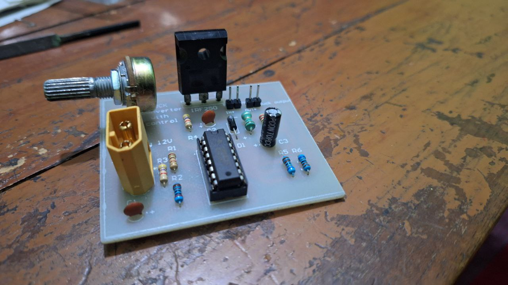
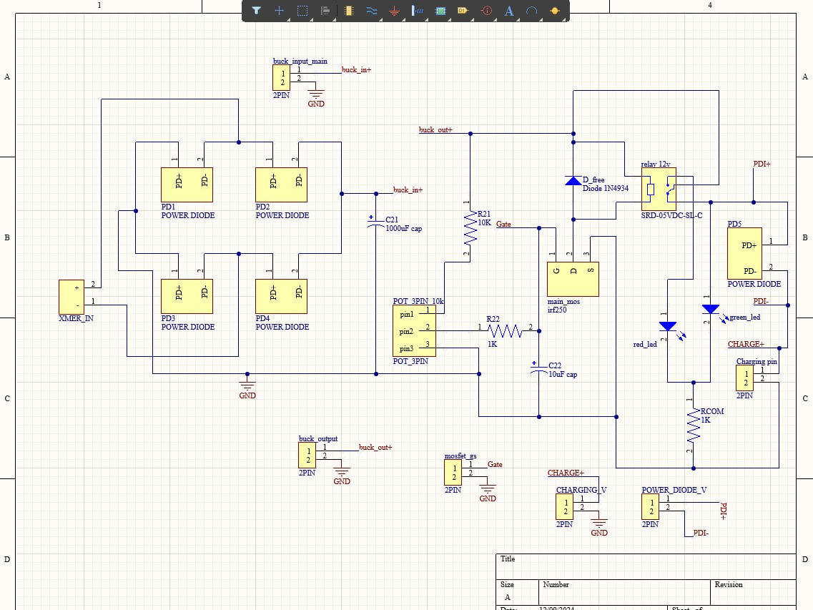
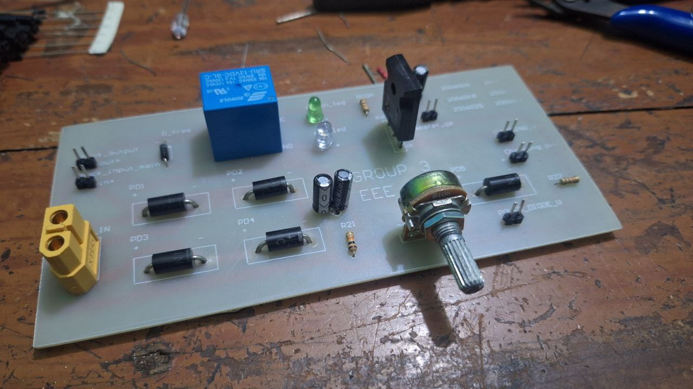

# Battery Charger with Automatic Cutoff and Custom Buck Converter

This project covers two circuits I designed in **Altium Designer**: a DC–DC buck converter and a battery charger with an adjustable automatic cutoff. The repository includes the original schematic and PCB design files, component libraries, circuit diagrams, and photographs of the assembled boards.

## Project overview

The charger design starts with a step-down transformer, a four-diode bridge rectifier, and a smoothing capacitor. A separate buck-converter stage is used to regulate the charging supply. The cutoff circuit uses a MOSFET, relay, and potentiometer to control when the charging connection is disconnected. Indicator LEDs are included on the charger board.

In testing, the cutoff was observed at **11.65 V**, compared with the set target of **11.67 V** (a difference of **0.02 V**). 
## 1. Custom DC–DC buck converter

The buck converter schematic uses an **SG3524** controller, an **IRF250 MOSFET**, a diode, an inductor, an output capacitor, and a feedback/control network. 

### Circuit schematic

### Assembled buck converter PCB

## 2. Battery charger with automatic cutoff

The charger schematic includes a four-diode bridge rectifier, filtering capacitor, adjustable potentiometer, MOSFET, relay, and charging-status LEDs. The relay is intended to disconnect the charging path at the selected cutoff threshold. 
### Circuit schematic

### Assembled charger PCB

## PCB layout images

The original PCB images:

### Charger PCB layout

### Buck converter PCB layout

## Repository contents

- `CHARGER.SchDoc`, `CHARGER.PcbDoc` — Altium schematic and PCB document for charger circuit board
- `PE.SchDoc`, `PE.PcbDoc` — Altium schematic and PCB document for the buck converter circuit board
- `Power_electronics.PrjPcb`, `Power_electronics_FULL.PrjPcb` — Altium project files
- `*.SchLib`, `*.PcbLib`, `*.intlib` — component and footprint libraries
- `images/` —  schematic screenshots and assembled-board photographs
- `charger pcb.jpg`, `custom buck converter pcb.jpg` — existing PCB layout images

